# Uveal Melanoma Clinical Registry

Version 0.1.0 (beta)

This repository describes the clinical registry of the Alberta Ocular Brachytherapy Program, which holds the clinical record for adults treated in that program. It holds the structure of that record and none of the data. The registry's page is on the lab site, [Ocular Oncology Outcomes Research](https://o3r.ca/uveal-melanoma-clinical-registry/).

## Files

`codebook.csv` is the data dictionary: 105 variables across 11 forms, one variable per row. Each row gives the variable's form, field type, label, codes, validation, identifier flag, and branching logic.

`schema.sql` is an empty SQLite database with one table per form. Every table is keyed on `studyid`. REDCap stores that key only on the patient form, but we repeated it on every table so the schema works without REDCap. Coded answers are stored as text, and the codes are in the code book. A checkbox can hold more than one code.

The code book comes from the registry's REDCap project. REDCap is still the system of record, so merging a pull request here changes nothing in the clinic's database; we decide what gets adopted there.

## Tables

Seven of the 11 tables are one row per patient. Imaging, brachytherapy, enucleation, and metastasis can repeat (e.g., a second plaque or another set of images), so those tables add `redcap_repeat_instance` to the key.

```mermaid
erDiagram
    patient_information ||--o| participant_information : "one row"
    patient_information ||--o| tumor_location : "one row"
    patient_information ||--o| tumor_characteristics : "one row"
    patient_information ||--o| tfsom : "one row"
    patient_information ||--o| gep : "one row"
    patient_information ||--o| death : "one row"
    patient_information ||--o{ imaging : "repeats"
    patient_information ||--o{ brachytherapy : "repeats"
    patient_information ||--o{ enucleation : "repeats"
    patient_information ||--o{ metastatic : "repeats"

    patient_information {
        TEXT studyid PK
    }
    participant_information {
        TEXT studyid PK, FK
    }
    tumor_location {
        TEXT studyid PK, FK
    }
    tumor_characteristics {
        TEXT studyid PK, FK
    }
    tfsom {
        TEXT studyid PK, FK
    }
    gep {
        TEXT studyid PK, FK
    }
    death {
        TEXT studyid PK, FK
    }
    imaging {
        TEXT studyid PK, FK
        INTEGER redcap_repeat_instance PK
    }
    brachytherapy {
        TEXT studyid PK, FK
        INTEGER redcap_repeat_instance PK
    }
    enucleation {
        TEXT studyid PK, FK
        INTEGER redcap_repeat_instance PK
    }
    metastatic {
        TEXT studyid PK, FK
        INTEGER redcap_repeat_instance PK
    }
```

| Table | Rows per patient | Variables |
|---|---|---|
| `patient_information` | One | 12 |
| `participant_information` | One | 4 |
| `tumor_location` | One | 9 |
| `tumor_characteristics` | One | 11 |
| `imaging` | One or more | 7 |
| `tfsom` | One | 8 |
| `gep` | One | 6 |
| `brachytherapy` | One or more | 39 |
| `enucleation` | One or more | 3 |
| `metastatic` | One or more | 3 |
| `death` | One | 3 |

`studyid` is counted once, on `patient_information`; the copies on the other tables and the `redcap_repeat_instance` column aren't counted.

## Using the code book in REDCap

The code book isn't a [REDCap](https://projectredcap.org/) data dictionary as it stands, but it's close. To import it, rename the columns to REDCap's data dictionary headers and put them in REDCap's order, change the identifier flag to `y` (blank for non-identifiers), and drop `instrument_note`. The field types, choice codes, and branching logic already use REDCap's syntax. One validation type, `phn_any`, may not exist on your REDCap server; replace it or leave it blank.

## Using it outside Canada

The registry was built for use in Canada, and three fields show it: the province list, the Canadian postal-code validation, and the provincial Personal Health Number. Those are the rows to change for another jurisdiction (e.g., a state list, a ZIP code validation, and your own health identifier).

## Patient-reported outcomes

We also collect the VF-14, the EQ-5D-5L, and the [PROM-UM](https://o3r.ca/prom-um/). We removed them from this release to avoid potential copyright conflicts.

## Versions

We use [semantic versioning](https://semver.org/). This is 0.1.0, a beta; until 1.0.0, variable names and codes may still change between releases. From 1.0.0 on, a renamed or removed variable (or a changed code) means a new major version, a new variable or form means a minor version, and a corrected label means a patch. Changes are listed in [CHANGELOG.md](CHANGELOG.md).

## Forks and proposals

If another centre wants to use the structure, fork the repository. If a label is wrong, a code is missing, or a form needs a new field, open an issue or a pull request and tell us what the field is for.

Keep patient information out of issues, pull requests, and commits. That means names, health numbers, dates tied to a person, and screenshots of a chart.

Nineteen columns are flagged as identifiers: names, the health number, date of birth, contact details, the Castle ID, and the dates of imaging, GEP testing, plaque insertion, enucleation, metastasis, and death. They're empty here, and they should stay empty in any public copy.

## Asking for patient-level data

There is no patient-level data in this repository. Requests go through the [registry's page](https://o3r.ca/uveal-melanoma-clinical-registry/) on the lab site.

We review the research question, its ethics status, and the fields you've chosen from this code book. Data are released only after that review and a signed data-use agreement. If there is a charge, it's a cost-recovery quote for preparing and transferring the extract, issued through the university; there's no price list.

## License

The code book and the empty schema are licensed under [Creative Commons Attribution 4.0 International](https://creativecommons.org/licenses/by/4.0/). Please credit the Uveal Melanoma Clinical Registry, Ocular Oncology Outcomes Research. The license doesn't cover any patient data.
